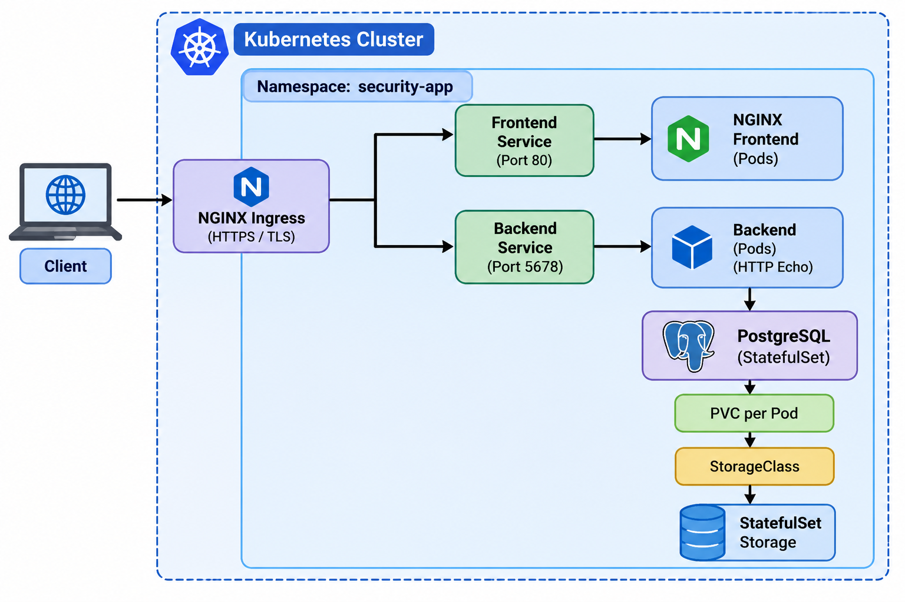
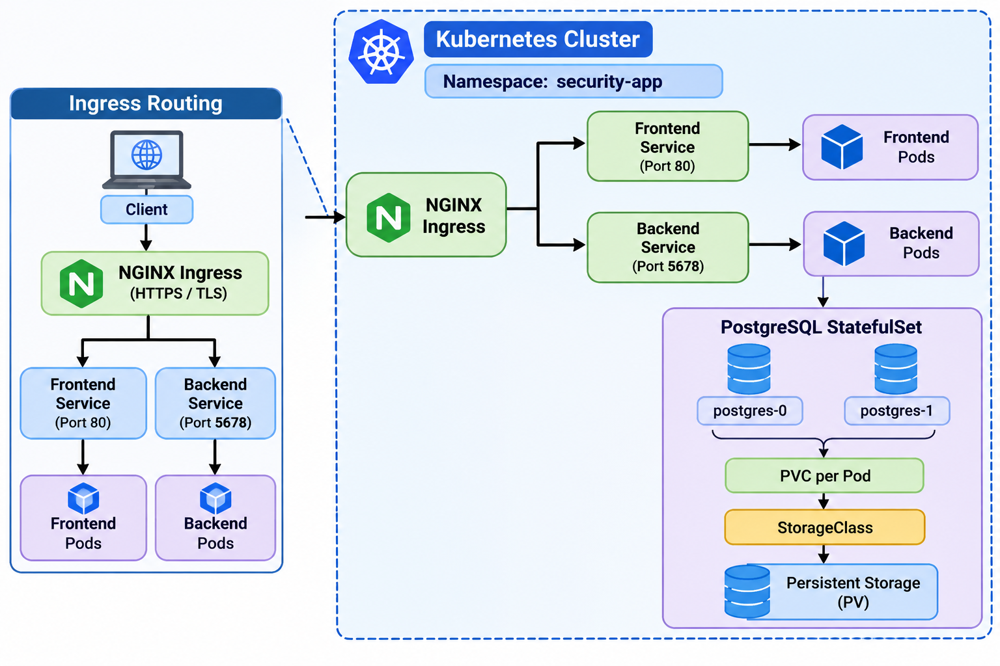

# Kubernetes Security, Storage & Networking Lab

A hands-on Kubernetes project built as part of my **CKA exam curriculum**, following Mumshad Mannambeth's Kubernetes course.

The project focuses on implementing and troubleshooting Kubernetes concepts through practical scenarios, resource configuration, access-control testing, and network connectivity verification.

## Project Overview

This lab uses a lightweight multi-tier application to practice Kubernetes administration and infrastructure concepts.

**Main Components:**
- **Frontend:** NGINX-based application.
- **Backend:** HTTP Echo service.
- **Database:** PostgreSQL StatefulSet.
- **Namespace:** `security-app`.
- **Cluster:** Minikube.

The primary focus is Kubernetes administration rather than application development.

## Architecture



**Ingress Routing:**



**Note:** PostgreSQL is deployed separately for storage and networking exercises. The backend is not configured as an application-level PostgreSQL client.

## Technologies & Kubernetes Concepts

| Area | Concepts Implemented |
|---|---|
| Workloads | Pods, Deployments, StatefulSets, ReplicaSets |
| Networking | Services, ClusterIP, Pod networking, DNS, Service Discovery, EndpointSlices |
| Ingress | NGINX Ingress, Path-based Routing, TLS |
| Network Security | NetworkPolicies, Ingress and Egress rules |
| Storage | PersistentVolumes, PersistentVolumeClaims, StorageClasses, StatefulSet volumeClaimTemplates |
| Authentication | ServiceAccounts, CertificateSigningRequests, Client Certificates, Kubeconfig |
| Authorization | RBAC, Roles, ClusterRoles, RoleBindings, ClusterRoleBindings |
| Configuration | ConfigMaps and Secrets |
| Troubleshooting | Pod failures, CrashLoopBackOff, Service connectivity, RBAC permission errors, storage issues |

## Repository Structure

```text
k8s-security-app/
│
├── config/
│   ├── frontend-config.yaml
│   ├── postgres-config.yaml
│   └── postgres-secret.yaml
│
├── manifests/
│   ├── namespace.yaml
│   ├── frontend-deployment.yaml
│   ├── frontend-service.yaml
│   ├── backend-deployment.yaml
│   ├── backend-service.yaml
│   ├── postgres-service.yaml
│   └── postgres-statefullsets.yaml
│
├── networking/
│   └── ingress-controller.yaml
│
├── security/
│   ├── authentication/
│   │   ├── cluster-service-account.yaml
│   │   └── frontend-service-accoutn.yaml
│   │
│   ├── certificates/
│   │   ├── dev-user.crt
│   │   ├── dev-user.csr
│   │   ├── dev-user.key
│   │   ├── tls.crt
│   │   └── tls.key
│   │
│   ├── network-policy/
│   │   ├── frontend-network-policy.yaml
│   │   ├── backend-network-policy.yaml
│   │   └── postgres-network-policy.yaml
│   │
│   ├── rbac/
│   │   ├── dev-user-role.yaml
│   │   ├── dev-user-rolebinding.yaml
│   │   ├── dev-user-csr.yaml
│   │   ├── cluster-pod-reader.yaml
│   │   ├── cluster-rolebinding.yaml
│   │   ├── frontend-role.yaml
│   │   └── frontend-rolebinding.yaml
│   │
│   └── security-context/
│
├── storage/
│   ├── postgres-pv.yaml
│   └── storage-class.yaml
│
├── screenshots/
├── tests/
├── task.py
└── README.md
```

**Repository notes:**
- PostgreSQL is managed through a StatefulSet; there is no separate PostgreSQL Deployment manifest in the current repository.
- `postgres-statefullsets.yaml` and `frontend-service-accoutn.yaml` retain their current filenames. Their spelling can be corrected as a separate cleanup.
- `cluster-rolebinding.yaml` currently defines a **RoleBinding**, not a ClusterRoleBinding.
- The `security-context/` directory is currently empty; Security Context implementation is not claimed as a completed feature.

## Implementation Highlights

### 1. Kubernetes Networking & Service Discovery

Implemented Kubernetes Services to provide stable access to application workloads.

**Practiced and verified:**
- Service selectors and target ports.
- Pod IP addresses and service endpoints.
- Internal communication between application components.
- DNS-based service discovery.
- Endpoint and EndpointSlice inspection.
- Connectivity testing between Frontend and Backend.

Useful commands:

```bash
kubectl get pods -n security-app -o wide
kubectl get svc -n security-app
kubectl get endpointslices -n security-app
kubectl describe svc backend-service -n security-app
```

### 2. Ingress & TLS

Configured an NGINX Ingress resource to route external HTTP traffic to internal Kubernetes Services.

**Implemented routing rules:**

| Path | Backend Service | Port |
|---|---|---:|
| `/` | frontend-service | 80 |
| `/api` | backend-service | 5678 |

Additional configuration:
- Host-based routing using `security-app.local`.
- NGINX Ingress Class.
- TLS configuration referencing the `security-app-tls` Secret.
- Path-based routing to multiple application components.

Manifest: `networking/ingress-controller.yaml`

### 3. Persistent Storage & StatefulSets

Configured PostgreSQL as a Kubernetes StatefulSet to understand persistent storage for stateful workloads.

**Implemented:**
- PersistentVolumes (PV).
- StorageClass configuration.
- StatefulSet `volumeClaimTemplates`.
- Individual PVC requests for StatefulSet replicas.
- Persistent volume mounting inside PostgreSQL containers.
- `ReadWriteOnce` access mode.
- `Retain` reclaim policy in the static PV configuration.

The StatefulSet requests a separate 1Gi PVC for each replica through `volumeClaimTemplates`.

The repository also contains a static 3Gi HostPath PersistentVolume definition and a `postgres-storage` StorageClass configuration.

**Important:** The static PV and the StatefulSet's dynamically requested PVCs are separate configurations. Successful binding and dynamic provisioning should be verified against the actual cluster resources before claiming that both storage paths are active.

The two PostgreSQL replicas have separate data directories. This configuration does not implement PostgreSQL replication or database high availability.

Useful commands:

```bash
kubectl get pv
kubectl get pvc -n security-app
kubectl get storageclass
kubectl describe pvc -n security-app
```

### 4. Authentication & Authorization (RBAC)

Implemented Kubernetes access-control scenarios using ServiceAccounts, client certificates, Roles, ClusterRoles, and bindings.

**Implemented:**
- Creating and assigning ServiceAccounts.
- Configuring Roles and ClusterRoles.
- Binding permissions with RoleBindings.
- Generating and submitting CertificateSigningRequests.
- Creating a separate Kubernetes user named `dev-user`.
- Configuring and using a separate kubeconfig context.
- Testing permissions using `kubectl auth can-i`.

**dev-user Role permissions:**

The `dev-user-role` grants permissions to:
- Get, list, watch, and create Pods.
- Get, list, watch, and create Deployments and ReplicaSets.

It does not grant the `delete` verb on Pods.

**ClusterRole scenario:**

A ClusterRole named `cluster-pod-reader` defines additional permissions for Pods, Deployments, and ReplicaSets. It is associated with the `cluster-reader-sa` ServiceAccount through a namespaced RoleBinding.

This demonstrates the distinction between ClusterRole definitions and the scope of RoleBindings.

Example commands:

```bash
kubectl auth can-i get pods -n security-app
kubectl auth can-i delete pods -n security-app
kubectl config get-contexts
kubectl get csr
```

### 5. ConfigMaps & Secrets

Configured application settings using Kubernetes ConfigMaps and Secrets.

**ConfigMaps:**
- `frontend-config`
- `postgres-config`

**Secret:**
- `postgres-secret`

PostgreSQL consumes configuration through `envFrom`, referencing both its ConfigMap and Secret.

This demonstrates separating application configuration from container image definitions.

**Security note:** Kubernetes Secret values encoded in YAML using Base64 are encoded, not automatically encrypted. Sensitive values should not be committed to public repositories.

### 6. NetworkPolicies

Created NetworkPolicy resources to define the intended communication boundaries between application components.

The configured rules include:

- Frontend Egress to Backend on TCP port `5678`.
- Frontend DNS Egress to CoreDNS on TCP/UDP port `53`.
- Backend Ingress from Frontend.
- PostgreSQL Ingress from Backend.

**Important:** NetworkPolicy resources are present in the repository, but enforcement depends on CNI support. The presence of these manifests alone does not prove that traffic restrictions are enforced.

Actual allowed and denied traffic must be verified using a NetworkPolicy-compatible CNI plugin before claiming successful enforcement.

Useful command:

```bash
kubectl get networkpolicies -n security-app
kubectl describe networkpolicy frontend-network-policy -n security-app
```

## Troubleshooting & Problem Solving

A significant part of this project involved investigating Kubernetes errors and understanding why resources behaved differently from expectations.

### 1. Service Port Mismatch

Encountered a connectivity issue caused by a mismatch between Service ports and the ports exposed by the target application.

**Troubleshooting approach:**
- Inspected Service configuration.
- Checked `port` and `targetPort`.
- Verified Pod listening ports.
- Tested connectivity from within the cluster.

### 2. RBAC Resource Name Errors

Encountered RBAC permission configuration issues, including using `pod` instead of the correct plural resource name `pods`.

**Troubleshooting approach:**
- Inspected Role rules.
- Checked API resource names.
- Verified permissions using `kubectl auth can-i`.

### 3. Role vs. ClusterRole

Investigated the difference between namespaced Roles and ClusterRoles, including how bindings determine the scope of granted permissions.

**Key takeaway:** A ClusterRole can be referenced by a RoleBinding, but the resulting permissions are limited to the RoleBinding's namespace.

### 4. dev-user Permission Testing

Tested the separate `dev-user` Kubernetes identity and verified authorization boundaries.

Scenarios included:
- Accessing permitted resources inside `security-app`.
- Receiving `Forbidden` responses when attempting operations outside the user's granted permissions.
- Verifying that deleting Pods was not allowed by the assigned Role.

### 5. PostgreSQL Storage & Pod Failures

Investigated PostgreSQL Pods entering `CrashLoopBackOff`.

The investigation included:
- Inspecting container logs.
- Identifying PostgreSQL WAL and checkpoint recovery errors.
- Checking PersistentVolume and PersistentVolumeClaim configuration.
- Understanding why multiple PostgreSQL instances should not share the same database data directory.
- Using StatefulSet volume claim templates to request separate storage per replica.

### 6. NetworkPolicy & CNI Compatibility

Investigated why applying NetworkPolicy resources did not necessarily block traffic.

**Key takeaway:** NetworkPolicy enforcement requires a compatible CNI implementation. Creating the Kubernetes resources alone is not sufficient.

## Screenshots & Proof of Implementation

The `screenshots/` directory contains evidence from practical exercises, including:

- Frontend connectivity tests.
- DNS and service discovery.
- RBAC allowed and denied operations.
- ServiceAccount configuration.
- Cross-namespace access tests.
- `dev-user` authentication and authorization tests.

Additional storage and NetworkPolicy enforcement screenshots can be added after validating the corresponding scenarios.

## Running the Lab

### Prerequisites

- Docker
- Minikube
- kubectl
- Basic Linux command-line knowledge

### Start Minikube

```bash
minikube start
```

### Create the Namespace

```bash
kubectl apply -f manifests/namespace.yaml
```

### Apply Configuration

```bash
kubectl apply -f config/
```

### Deploy Application Workloads

```bash
kubectl apply -f manifests/
```

### Apply Storage Resources

```bash
kubectl apply -f storage/storage-class.yaml
kubectl apply -f storage/postgres-pv.yaml
```

### Apply Security Resources

Apply the required authentication, RBAC, and NetworkPolicy manifests according to their dependencies.

### Configure Ingress

Ensure the NGINX Ingress Controller is installed and running, then apply:

```bash
kubectl apply -f networking/ingress-controller.yaml
```

TLS configuration also requires the referenced `security-app-tls` Secret to exist.

### Verify Resources

```bash
kubectl get all -n security-app
kubectl get pv
kubectl get pvc -n security-app
kubectl get storageclass
kubectl get ingress -n security-app
kubectl get networkpolicies -n security-app
```

**Note:** The commands above describe the main deployment workflow. Apply resources in the appropriate order and verify storage provisioning, TLS configuration, and CNI support for your Minikube setup.

## Key Takeaways

Through this project, I gained practical experience with:

- Deploying and managing Kubernetes workloads.
- Understanding Kubernetes networking, Services, DNS, and Ingress.
- Configuring TLS and path-based routing.
- Managing stateful workloads using StatefulSets and persistent storage.
- Working with PVs, PVCs, and StorageClasses.
- Implementing authentication and authorization using RBAC.
- Managing application configuration with ConfigMaps and Secrets.
- Defining workload communication policies using NetworkPolicies.
- Troubleshooting real Kubernetes issues through logs, events, resource inspection, and permission testing.

## Learning Resources

- [Certified Kubernetes Administrator (CKA) – Mumshad Mannambeth](https://www.udemy.com/course/certified-kubernetes-administrator-with-practice-tests/)
- [Kubernetes Official Documentation](https://kubernetes.io/docs/)
- [Kubernetes Networking](https://kubernetes.io/docs/concepts/cluster-administration/networking/)
- [Kubernetes Storage](https://kubernetes.io/docs/concepts/storage/)

---

**This project is part of my hands-on journey toward becoming a Kubernetes and DevOps Engineer.**